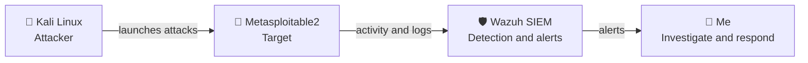
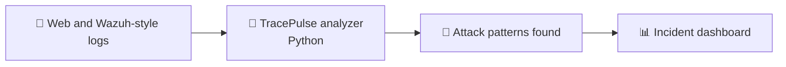
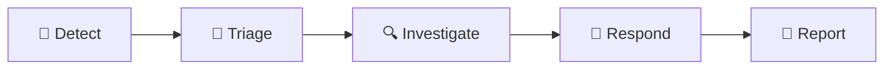
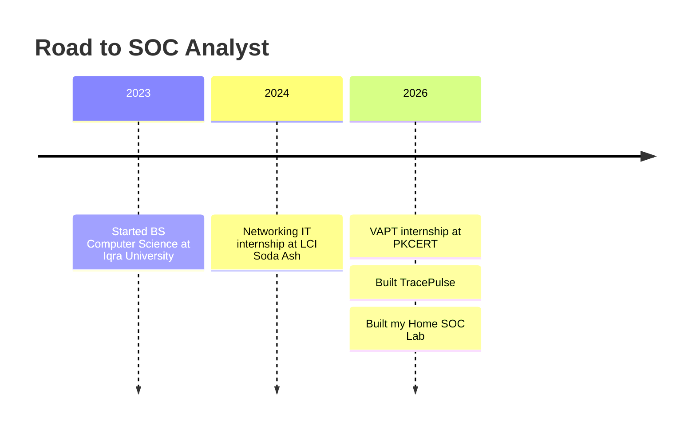

<div align="center">


[](https://www.linkedin.com/in/tayyaba-ejaz)


</div>

---

## 👩‍💻 whoami

```bash
tayyaba@soc:~$ whoami
> Final-year BS Computer Science student | Islamabad, Pakistan
tayyaba@soc:~$ cat focus.txt
> Cybersecurity | Networking | Defensive Security | SIEM
tayyaba@soc:~$ cat mindset.txt
> VAPT internship at PKCERT taught me how attackers think.
> Now I use that to detect, investigate and respond as a SOC analyst.
```

---

## 🛡️ My Home SOC Lab

[**SOC-Home-Lab**](https://github.com/tayyaba-cyber/SOC-Home-Lab): built from scratch to practice attack detection and investigation.



---

## 📊 TracePulse: Log Analyzer and Incident Dashboard

[**TracePulse**](https://github.com/tayyaba-cyber/TracePulse) finds attack patterns in web and Wazuh-style logs.



---

## 🔁 The SOC workflow I practice



---

## 🧰 Tech Stack


---

## 🗺️ My Journey



---

<div align="center">

### 📫 Let's connect

[](https://www.linkedin.com/in/tayyaba-ejaz)


</div>
